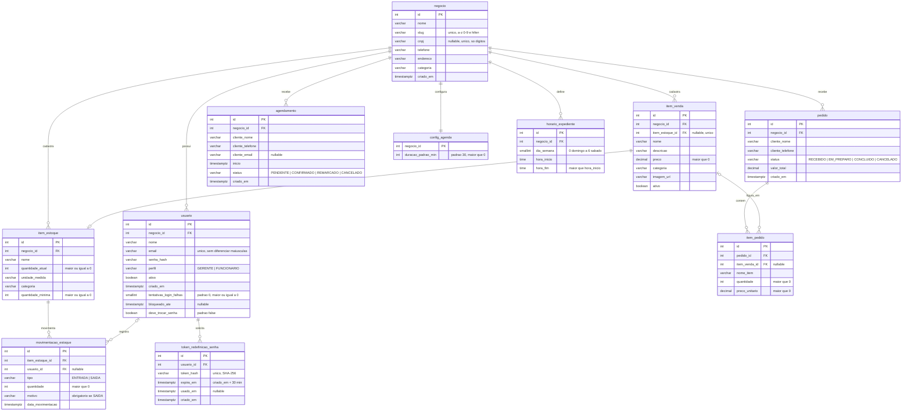
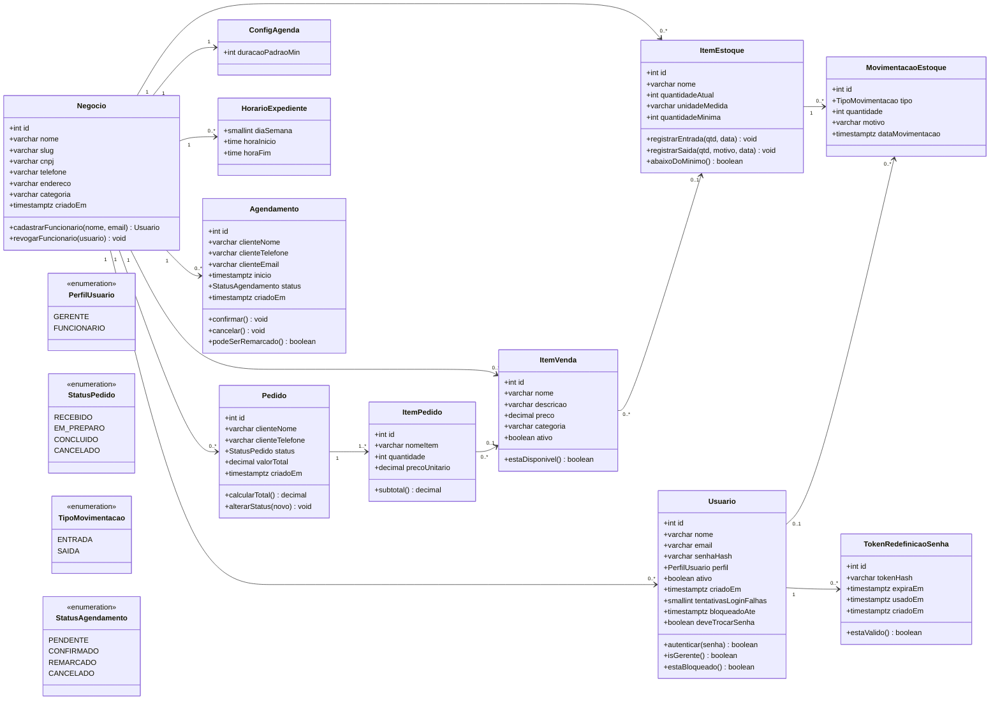

# Modelagem de Banco de Dados — Conecta+

**Versão:** 1.3 
**SGBD de referência:** Supabase PostgreSQL

---

## 1. Visão geral

Modelo enxuto para os três módulos do sistema (Mercado, Estoque e Agenda) mais a conta do negócio.

- Toda tabela tem `id` como chave primária.
- Toda tabela de dados de negócio tem `negocio_id` (cada conta = um único negócio).
- Bloqueio por tentativas de login (RF04), redefinição de senha (RF05) e troca obrigatória da senha temporária (RF09) são guardados no banco: colunas em `usuario` e a tabela `token_redefinicao_senha`.
- Log de auditoria e envio de e-mails ficam na **camada da aplicação** e não foram modelados como tabela, para reduzir complexidade.
- Senhas são gravadas apenas como hash (bcrypt).
- Todos os campos de data/hora (`negocio.criado_em`, `usuario.criado_em`, `pedido.criado_em`, `movimentacao_estoque.data_movimentacao`, `agendamento.inicio`, `agendamento.criado_em`, `usuario.bloqueado_ate`, `token_redefinicao_senha.expira_em`/`usado_em`/`criado_em`) são `timestamptz`, com padrão `now()` onde se aplica (`criado_em` e `data_movimentacao`).

**Tabelas:** `negocio`, `usuario`, `item_venda`, `pedido`, `item_pedido`, `item_estoque`, `movimentacao_estoque`, `config_agenda`, `horario_expediente`, `agendamento`, `token_redefinicao_senha`.

---

## 2. Diagrama entidade-relacionamento



### 2.1 Relacionamentos e regras de exclusão

| Ao excluir | Efeito |
|---|---|
| `negocio` | Apaga em cascata todos os dados dele (`usuario`, `item_venda`, `item_estoque`, `pedido`, `agendamento`, `config_agenda`, `horario_expediente` e, por consequência, `item_pedido` e `movimentacao_estoque`). |
| `item_estoque` | Apaga suas `movimentacao_estoque`; `item_venda.item_estoque_id` fica nulo. |
| `usuario` | `movimentacao_estoque.usuario_id` fica nulo (a movimentação é mantida); apaga seus `token_redefinicao_senha`. |
| `pedido` | Apaga seus `item_pedido`. |
| `item_venda` | `item_pedido.item_venda_id` fica nulo; o histórico do pedido é mantido por `nome_item` e `preco_unitario` (RF15). |

---

## 3. Diagrama de classes

Mesmas entidades em forma de classe, com os poucos métodos que carregam regra de negócio.



---

## 4. Dicionário de dados (resumido)

| Tabela | Colunas principais | Observações |
|---|---|---|
| **negocio** | id, nome, slug, cnpj, telefone, endereco, categoria, criado_em | `slug` varchar(60), único, só minúsculas, números e hífen: URL pública da vitrine e da agenda (RF16, RF17, RF33); `cnpj` varchar(14), opcional, único quando preenchido, armazenado só com dígitos (sem máscara), dígito verificador validado na aplicação (RF02A–C) |
| **usuario** | id, negocio_id, nome, email, senha_hash, perfil, ativo, criado_em | `email` único sem diferenciar maiúsculas de minúsculas (RF02); `perfil` GERENTE/FUNCIONARIO (RF11); `ativo=false` revoga acesso (RF10); `tentativas_login_falhas` e `bloqueado_ate` controlam o bloqueio de 15 min após 5 senhas incorretas seguidas (RF04); `deve_trocar_senha=true` obriga a definir nova senha no próximo login (RF09) |
| **item_venda** | id, negocio_id, item_estoque_id, nome, descricao, preco, categoria, imagem_url, ativo | `preco > 0` (RN03); vitrine mostra só `ativo=true` (RF16); `item_estoque_id` opcional e único (RF25, RN01) |
| **pedido** | id, negocio_id, cliente_nome, cliente_telefone, status, valor_total, criado_em | Cliente sem login (RF18); `status` com 4 valores (RF20); `criado_em` usado nos relatórios (RF40) |
| **item_pedido** | id, pedido_id, item_venda_id, nome_item, quantidade, preco_unitario | `nome_item` varchar(120), obrigatório = cópia do nome do produto no momento do pedido; `preco_unitario` = cópia do preço no momento do pedido, `> 0`; `quantidade > 0`; `item_venda_id` aceita nulo (ON DELETE SET NULL), para excluir um item de venda (RF15) sem perder o histórico |
| **item_estoque** | id, negocio_id, nome, quantidade_atual, unidade_medida, categoria, quantidade_minima | Alerta quando `quantidade_atual <= quantidade_minima` (RF28); `quantidade_minima >= 0` (RN04); `quantidade_atual >= 0` |
| **movimentacao_estoque** | id, item_estoque_id, usuario_id, tipo, quantidade, motivo, data_movimentacao | `tipo` ENTRADA/SAIDA (RF24, RF27); `quantidade > 0`; `motivo` obrigatório na saída; `usuario_id` = responsável (RF29) |
| **config_agenda** | negocio_id, duracao_padrao_min | 1 registro por negócio (RF32); `duracao_padrao_min > 0`, padrão 30 |
| **horario_expediente** | id, negocio_id, dia_semana, hora_inicio, hora_fim | Dias e faixas de atendimento (RF31); `dia_semana` smallint de 0 (domingo) a 6 (sábado); `hora_inicio`/`hora_fim` do tipo `time`, com `hora_fim > hora_inicio`; várias faixas por dia são permitidas (ex.: pausa de almoço), mas não duas com o mesmo início no mesmo dia |
| **agendamento** | id, negocio_id, cliente_nome, cliente_telefone, cliente_email, inicio, status, criado_em | `status` com 4 valores (RF37); índice único parcial em (`negocio_id`, `inicio`) onde `status = 'CONFIRMADO'` (RF35); índice em (`negocio_id`, `cliente_telefone`) para o histórico (RF39) |
| **token_redefinicao_senha** | id, usuario_id, token_hash, expira_em, usado_em, criado_em | Link de redefinição de senha (RF05). Guarda só o hash SHA-256 do token, nunca o token em si; `expira_em` = `criado_em` + 30 min; `usado_em` preenchido quando o token é usado (só pode ser usado uma vez) |

### 4.1 Restrições no banco

Além da validação na aplicação, o banco também garante:

| Restrição | Origem |
|---|---|
| `item_venda.preco > 0` | RN03 |
| `item_estoque.quantidade_minima >= 0` | RN04 |
| `item_estoque.quantidade_atual >= 0` | — |
| `movimentacao_estoque.quantidade > 0` | — |
| `movimentacao_estoque.motivo` obrigatório quando `tipo = 'SAIDA'` | RF27 |
| `item_pedido.quantidade > 0` e `item_pedido.preco_unitario > 0` | — |
| `config_agenda.duracao_padrao_min > 0`, padrão 30 | RF32 |
| `pedido.status`, `agendamento.status`, `movimentacao_estoque.tipo` e `usuario.perfil` limitados aos valores dos enums | RF11, RF20, RF37 |
| `item_venda.item_estoque_id` único | RN01 |
| `negocio.slug` único e no formato minúsculas/números/hífen | RF16, RF17, RF33 |
| `horario_expediente`: `dia_semana` entre 0 e 6, `hora_fim > hora_inicio`, único por (`negocio_id`, `dia_semana`, `hora_inicio`) | RF31 |
| Um único agendamento `CONFIRMADO` por (`negocio_id`, `inicio`) | RF35 |
| `usuario.tentativas_login_falhas >= 0` | RF04 |
| `token_redefinicao_senha.token_hash` único e `expira_em > criado_em` | RF05 |

---

## 5. Regras de negócio no sistema

Implementadas na camada de aplicação (Model/serviços), não só no banco:

| Regra | Descrição |
|---|---|
| RF21 | Quando `item_estoque.quantidade_atual` chega a 0, o `item_venda` associado sai da vitrine (`ativo=false`). |
| RF26 | Ao mudar `pedido.status` para `CONCLUIDO`, gera `movimentacao_estoque` de SAIDA e abate o estoque associado. |
| RF24 / RF27 | Toda movimentação atualiza `item_estoque.quantidade_atual`. |
| RF35 | Não pode haver dois agendamentos `CONFIRMADO` no mesmo horário (também garantido no banco por índice único parcial). |
| RN01 | Um `item_venda` associa-se a no máximo um `item_estoque` (`item_estoque_id` único). |
| RN02 | Agendamento `CANCELADO` não pode ser remarcado; deve ser criado um novo agendamento (o cancelado é mantido no histórico). |
| RN03 | `item_venda.preco` deve ser maior que zero. |
| RN04 | `item_estoque.quantidade_minima` não pode ser negativa. |
| RF04 | Senha incorreta soma 1 em `usuario.tentativas_login_falhas`; na 5ª seguida, grava `bloqueado_ate = now() + 15 min`. Login com sucesso zera o contador e limpa `bloqueado_ate`. Enquanto `bloqueado_ate > now()`, o login é recusado mesmo com a senha certa. |
| RF05 | Ao pedir redefinição, gera um token aleatório, envia o link por e-mail e grava só o hash em `token_redefinicao_senha`. O token vale se `usado_em` for nulo e `expira_em > now()`. Ao redefinir, grava `usado_em`, troca `senha_hash` e zera o bloqueio. Se o e-mail não existir, a resposta é a mesma, para não revelar quais e-mails estão cadastrados. |
| RF09 | Ao cadastrar um Funcionário com senha temporária (RF08), grava `deve_trocar_senha = true`. Enquanto estiver `true`, após o login o usuário só pode acessar a tela de nova senha. Ao definir a nova senha, grava `false`. O Gerente que cria a própria conta (RF01) começa com `false`. |

**Relatórios (RF40–RF43):** são consultas por intervalo de datas sobre `pedido`, `movimentacao_estoque` e `agendamento`. Não precisam de tabelas próprias.

---

## 6. Segurança e acesso ao banco

- O banco é Supabase PostgreSQL (projeto `qpauincpahhhamouclry`, região us-east-1).
- RLS (Row Level Security) está habilitado em todas as tabelas, **sem políticas**: a API pública do Supabase (PostgREST) fica bloqueada. Só o backend C# (Railway) acessa os dados, por conexão direta com a connection string do Postgres. **Não usar** a chave anon/publishable para acessar dados.
- A autenticação é própria (tabela `usuario` + bcrypt), sem Supabase Auth.
- O token de redefinição de senha nunca é gravado em texto: o banco guarda só o hash SHA-256. Quem ler o banco não consegue montar um link válido.
- A função `public.rls_auto_enable()` (event trigger `ensure_rls`) foi ativada na criação do projeto e liga o RLS automaticamente em toda tabela nova do schema `public`. Deve ser mantida. O aviso do Supabase sobre ela poder ser executada por `anon` não é um risco real: funções do tipo `event_trigger` não podem ser chamadas diretamente.
- As regras RF21, RF24, RF26 e RF27 (estoque e vitrine) continuam na aplicação e precisam de **transação**: atualizar `item_estoque.quantidade_atual` e inserir a `movimentacao_estoque` juntos.

### 6.1 Migration de autenticação (RF04, RF05, RF09)

DDL aplicado no Supabase em 07/11/2026 pela migration `conecta_autenticacao_apoio`, depois da migration inicial `conecta_schema_inicial`.

```sql
alter table public.usuario
  add column tentativas_login_falhas smallint not null default 0 check (tentativas_login_falhas >= 0),
  add column bloqueado_ate timestamptz,
  add column deve_trocar_senha boolean not null default false;

create table public.token_redefinicao_senha (
  id integer generated always as identity primary key,
  usuario_id integer not null references public.usuario(id) on delete cascade,
  token_hash varchar(64) not null unique,
  expira_em timestamptz not null,
  usado_em timestamptz,
  criado_em timestamptz not null default now(),
  check (expira_em > criado_em)
);
create index token_redefinicao_usuario_idx on public.token_redefinicao_senha (usuario_id);
-- RLS e ligado automaticamente pela rls_auto_enable(); a linha abaixo deixa explicito
alter table public.token_redefinicao_senha enable row level security;
```

---

## 7. E-mail no agendamento

`agendamento.cliente_email` é opcional (RF34). A notificação por e-mail (RF38) só é enviada quando o Cliente informou e-mail; sem e-mail, nenhuma notificação é enviada.

---

## 8. Histórico de versões

| Versão | Data | Alteração |
|---|---|---|
| 1.0 | — | Versão inicial. |
| 1.1 | 07/11/2026 | Sincronização com o banco criado no Supabase: `negocio.slug` e `criado_em`; `cnpj` varchar(14) só com dígitos; `usuario.criado_em` e e-mail único sem diferenciar maiúsculas; `horario_expediente` com `time`, `dia_semana` smallint 0–6 e várias faixas por dia; `item_pedido.nome_item` e `item_venda_id` nulável (ON DELETE SET NULL); `agendamento.criado_em` e índices de RF35/RF39; datas em `timestamptz`; restrições CHECK no banco (seção 4.1); regras de exclusão (seção 2.1); RN02 citando só `CANCELADO`; nova seção 6, Segurança e acesso ao banco; seção 7 registra que o e-mail do agendamento é opcional e só é usado para notificar quem o informou. |
| 1.2 | 07/11/2026 | Modelagem de RF04 (colunas `tentativas_login_falhas` e `bloqueado_ate` em `usuario`), RF09 (coluna `deve_trocar_senha` em `usuario`) e RF05 (tabela `token_redefinicao_senha`), com DDL proposto na seção 6.1, **ainda não aplicado no Supabase**; documentada a função `rls_auto_enable()` na seção 6. |
| 1.3 | 07/11/2026 | Migration `conecta_autenticacao_apoio` aplicada no Supabase: colunas `tentativas_login_falhas`, `bloqueado_ate` e `deve_trocar_senha` em `usuario` e tabela `token_redefinicao_senha` (com RLS). Removidas as marcações "planejado". |
