# Conecta+ — Fluxograma do projeto

Este documento mostra como o Conecta+ funciona hoje, do navegador até o banco.
Os diagramas usam [Mermaid](https://mermaid.js.org/) e aparecem desenhados no GitHub e no VS Code (com a extensão *Markdown Preview Mermaid Support*).

> **Legenda de estado do projeto**
> - **Real**: já passa pelo backend C# e grava no Supabase (cadastro, login, sessão, sair).
> - **Demo**: roda só no navegador, com dados de exemplo em memória (`frontend/js/state.js` + `data.js`). Some ao recarregar a página.

Sumário:

1. [Arquitetura geral](#1-arquitetura-geral)
2. [Como o frontend carrega e navega](#2-como-o-frontend-carrega-e-navega)
3. [Mapa de telas](#3-mapa-de-telas)
4. [Cadastro do negócio (gerente)](#4-cadastro-do-negócio-gerente)
5. [Cadastro do cliente](#5-cadastro-do-cliente)
6. [Login](#6-login)
7. [Requisição autenticada e renovação do token](#7-requisição-autenticada-e-renovação-do-token)
8. [Sair (logout)](#8-sair-logout)
9. [Pedido feito pelo cliente](#9-pedido-feito-pelo-cliente-demo)
10. [Novo pedido no balcão e fiado](#10-novo-pedido-no-balcão-e-fiado-demo)
11. [Status do pedido](#11-status-do-pedido-demo)
12. [Estoque](#12-estoque-demo)
13. [Banco de dados](#13-banco-de-dados)

---

## 1. Arquitetura geral

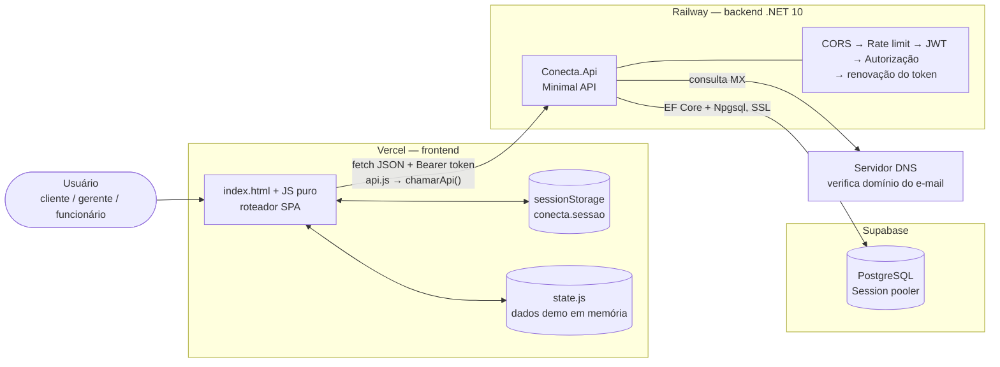

| Camada | Onde fica | Arquivos principais |
|---|---|---|
| Frontend | Vercel | `frontend/index.html`, `frontend/js/*`, `frontend/vercel.json` |
| Backend | Railway (Docker) | `backend/src/Conecta.Api/Program.cs`, `Endpoints/`, `Seguranca/` |
| Banco | Supabase | `docs/schema.sql` (sem migrations do EF) |

---

## 2. Como o frontend carrega e navega

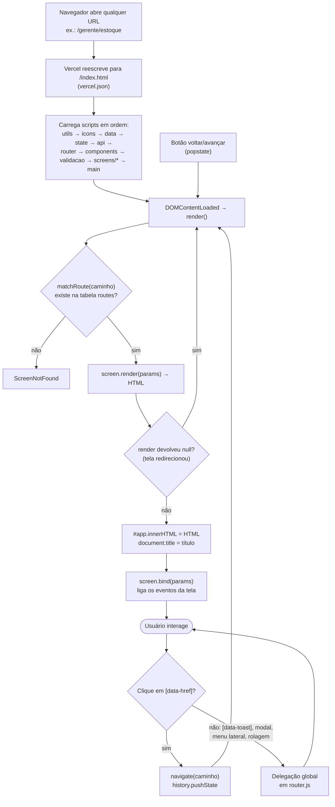

---

## 3. Mapa de telas

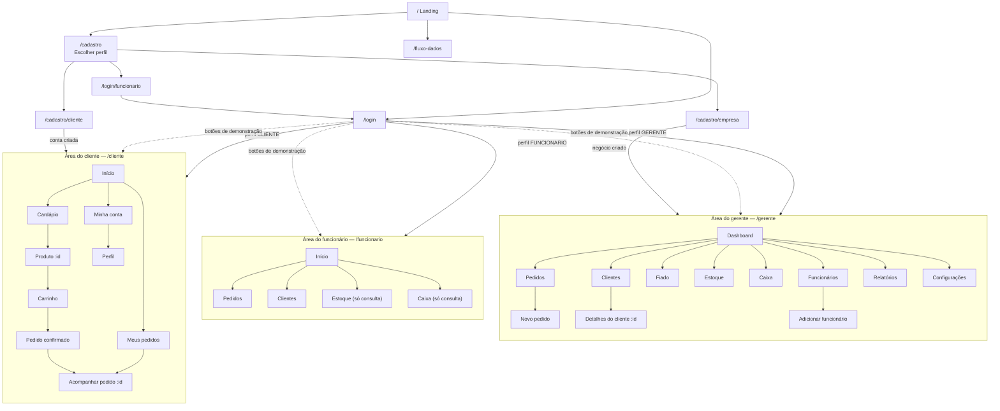

> As rotas `/cliente`, `/gerente` e `/funcionario` ainda **não** são protegidas no frontend (há um `TODO(backend)` em `router.js`). Quem garante a permissão é o backend, nas rotas que exigem token.

---

## 4. Cadastro do negócio (gerente)

`POST /api/auth/cadastro` — **Real** (RF01, RF02, RF02A-C)

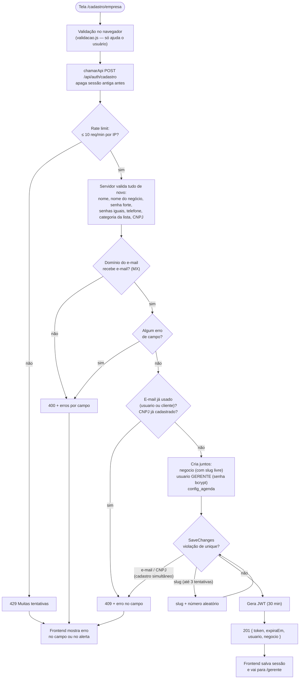

---

## 5. Cadastro do cliente

`POST /api/auth/cadastro-cliente` — **Real** (RF18A). A conta do cliente é opcional.

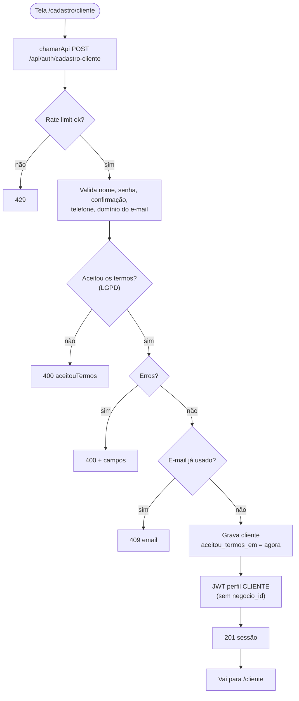

---

## 6. Login

`POST /api/auth/login` — **Real** (RF03, RF04, RF10). Uma tela só: o servidor descobre se é equipe ou cliente pelo e-mail.

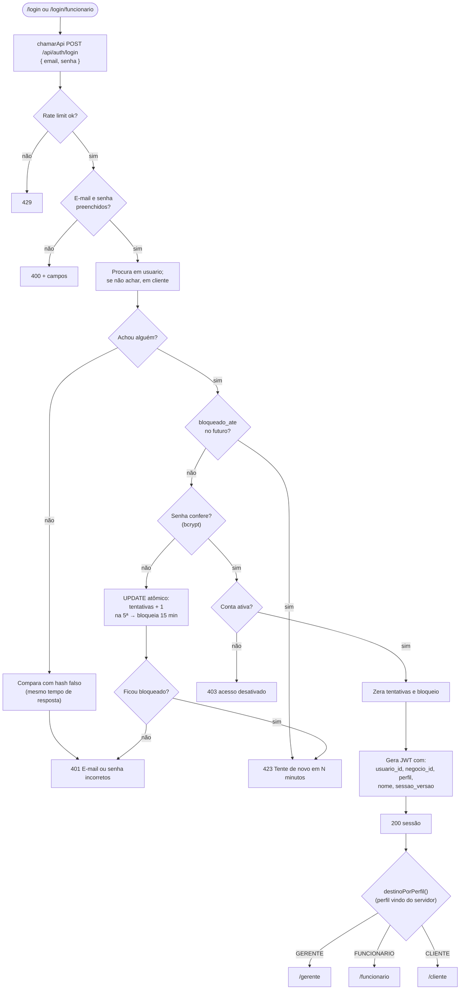

---

## 7. Requisição autenticada e renovação do token

Vale para `GET /api/auth/eu`, `POST /api/auth/sair` e toda rota futura com `RequireAuthorization`.

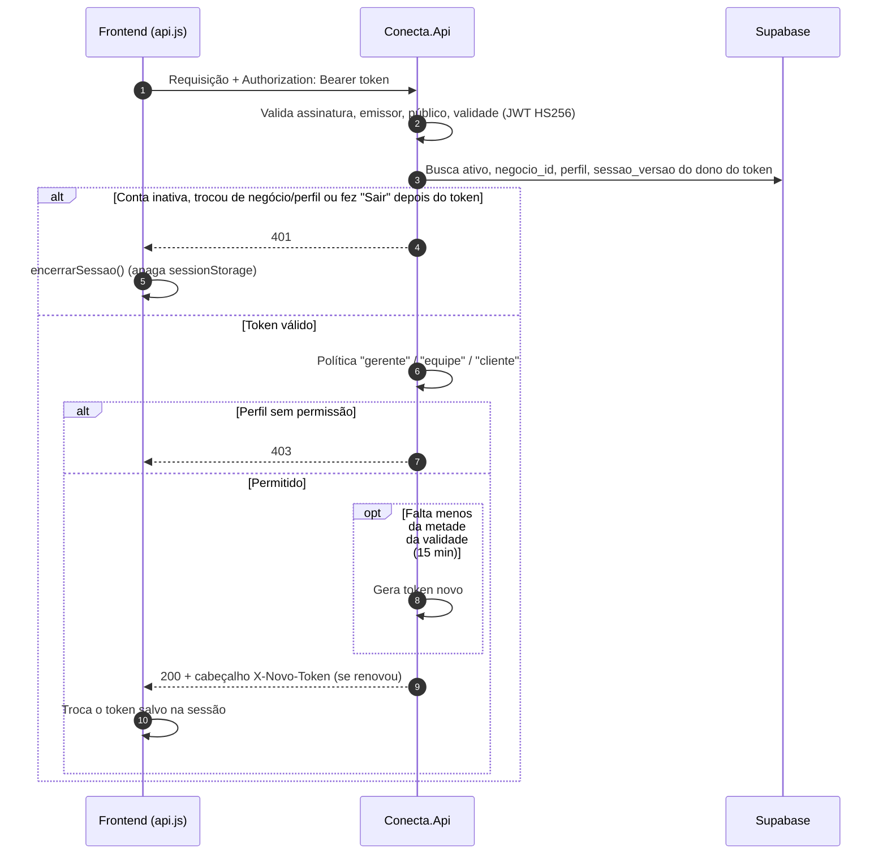

---

## 8. Sair (logout)

`POST /api/auth/sair` — **Real** (RF06)

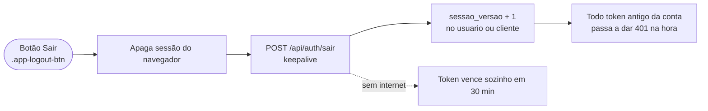

---

## 9. Pedido feito pelo cliente (Demo)

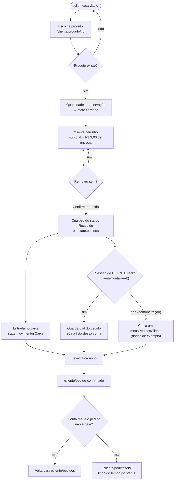

**Minha carteira e Meus pedidos:** na demonstração mostram os números de exemplo (R$ 56,00 etc.). Na conta real começam zerados e são calculados a partir dos pedidos que a própria conta fez. O saldo devedor da conta real é sempre R$ 0,00, porque o banco ainda não tem fiado nem liga `pedido` a `cliente`.

---

## 10. Novo pedido no balcão e fiado (Demo)

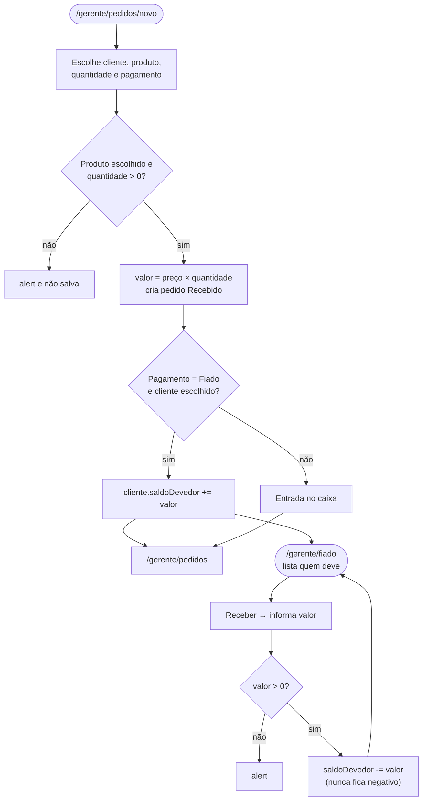

---

## 11. Status do pedido (Demo)

Na lista de pedidos, clicar no selo de status avança para o próximo (`PROXIMO_STATUS` em `state.js`).

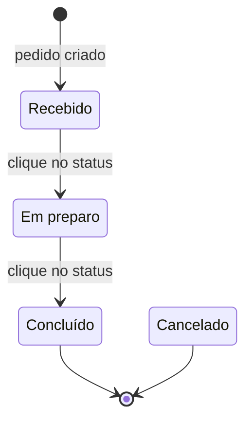

> `Concluído` e `Cancelado` são finais: o selo vira texto e não é mais clicável. O filtro da tela do gerente separa Todos / Em preparo / Concluídos / Cancelados.

---

## 12. Estoque (Demo)

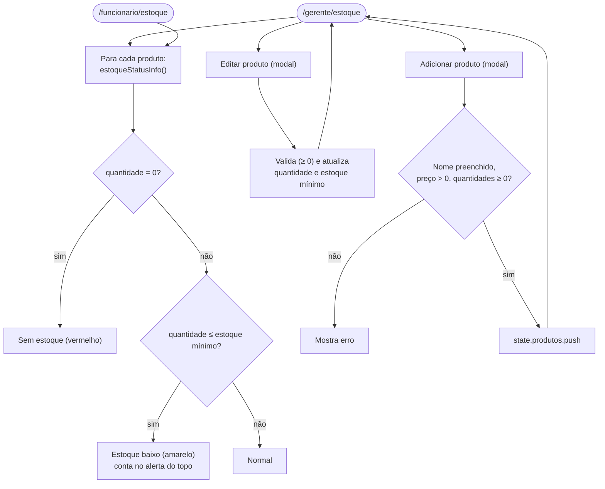

---

## 13. Banco de dados

Tabelas do `docs/schema.sql`. As que o backend já usa: **negocio**, **usuario**, **cliente**, **config_agenda**. As outras estão criadas e esperam os próximos módulos (estoque, pedidos, agenda, redefinição de senha).

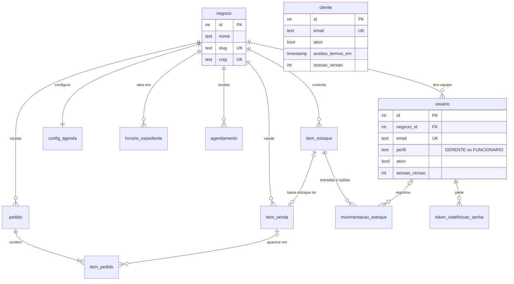

> `cliente` não tem chave estrangeira para `negocio`: a conta do cliente é global (um cliente pode comprar de vários negócios). O mesmo e-mail não pode existir em `usuario` e `cliente` ao mesmo tempo — o backend confere as duas tabelas.
